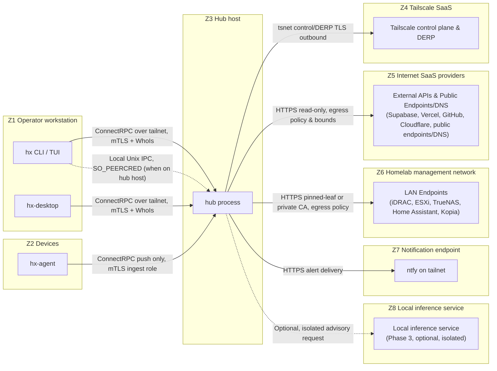
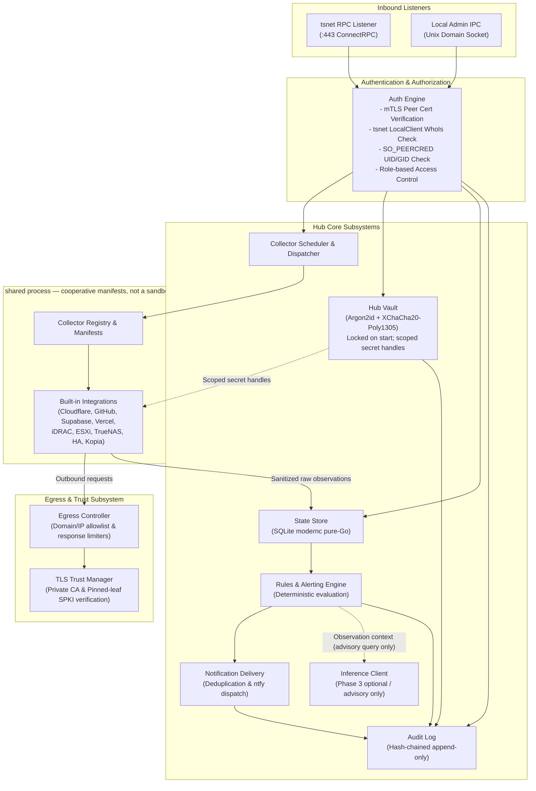
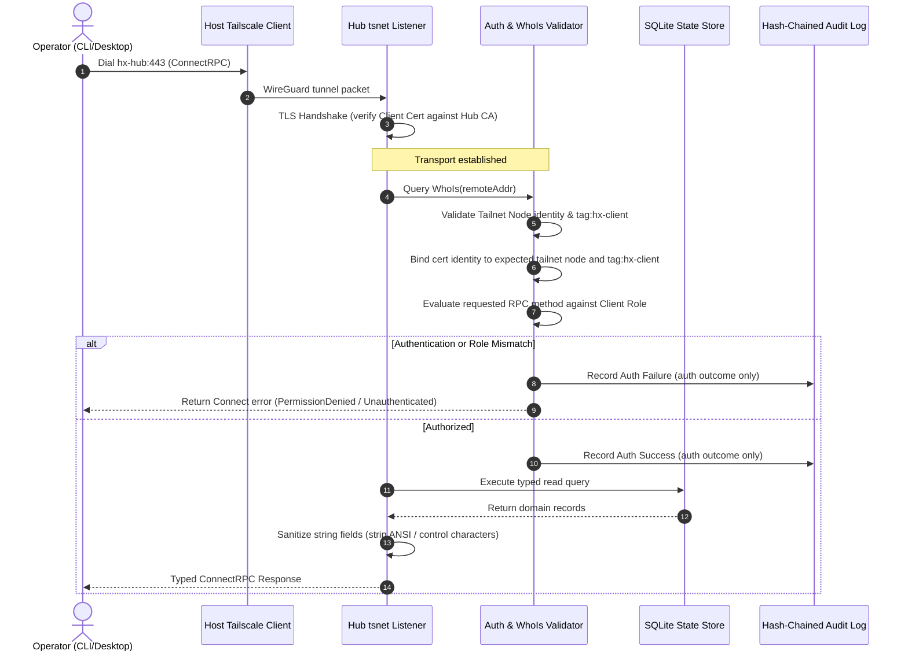
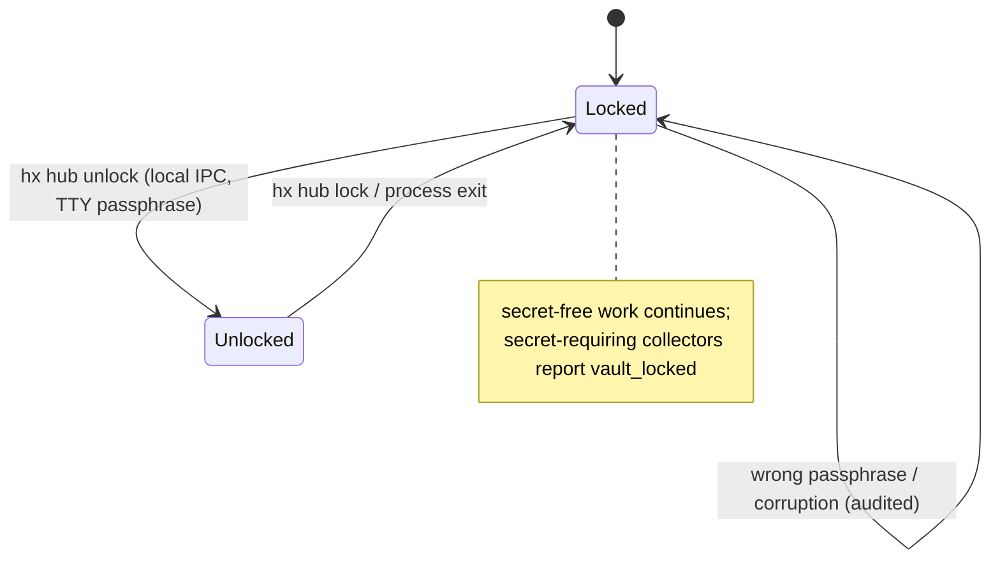

# Architecture Overview

## Purpose and Status

This document defines the high-level architecture, components, trust zones, and runtime data flows for `hx`.

Runtime capabilities described here remain **Planned**. [F02 (#10)](https://github.com/hndrxc/hx/issues/10) adds the Go module, command entry points, help/version output and import-policy checks; hub, TUI, desktop and agent runtimes explicitly fail as unimplemented. See the [build guide](../build.md) for the current executable surface. Framework feasibility evidence remains the historical throwaway [F01 spike](../spikes/2026-11-build-feasibility.md); each runtime capability is mapped to its owning issue.

Related design and security documents:
- [Threat Model and Trust Boundaries](../security/threat-model.md)
- [Architecture Decision Records](../adr/README.md)
- [Compatibility and Capability Matrix](../compatibility.md)
- [AI Investigation Inputs](../ai-investigation-inputs.md)

---

## Components

The system consists of three distinct binaries built from the single repository module:
1. `hx`: Unified Cobra CLI binary providing two major roles via distinct code paths:
   - `hx hub`: Long-running central control, collector, storage, and policy service.
   - `hx tui`: Interactive terminal user interface client (Charm Bubble Tea v2) dialing the hub.
2. `hx-desktop`: Thin cross-platform desktop UI (Wails v3 + React/TypeScript) dialing the hub.
3. `hx-agent`: Lightweight outbound-only daemon collecting host and hardware metrics, pushing observations to the hub.

| Binary | Role | Holds | Never Holds | Owning Issues |
| :--- | :--- | :--- | :--- | :--- |
| `hx` (`hub`) | Central daemon: orchestrates collectors, maintains state, evaluates rules, issues notifications, hosts ConnectRPC over tsnet and local admin IPC. | Provider credentials (vault), hub CA private key and certificate, audit log, SQLite state store, tsnet node identity and state. | Plaintext credentials on disk; client/agent enrollment private keys (only issues certificates against them). | [#10](https://github.com/hndrxc/hx/issues/10) (F02), [#14](https://github.com/hndrxc/hx/issues/14) (S02), [#19](https://github.com/hndrxc/hx/issues/19) (S08), [#22](https://github.com/hndrxc/hx/issues/22) (D01), [#23](https://github.com/hndrxc/hx/issues/23) (D02), [#43](https://github.com/hndrxc/hx/issues/43) (O01) |
| `hx` (`tui` / CLI) | Operator interface: runs locally on operator workstation; dials hub over tailnet via host Tailscale client or local Unix socket on hub host. | Own client enrollment private key, client mTLS certificate, hub CA public certificate, local cached terminal settings. | Provider credentials, vault keys, other client or agent keys, raw SQLite state file. | [#10](https://github.com/hndrxc/hx/issues/10) (F02), [#18](https://github.com/hndrxc/hx/issues/18) (S07), [#19](https://github.com/hndrxc/hx/issues/19) (S08), [#53](https://github.com/hndrxc/hx/issues/53) (C01), [#54](https://github.com/hndrxc/hx/issues/54) (C02) |
| `hx-desktop` | Graphical workstation client: displays state, topology, and alerts via embedded webview (Wails v3). | Own client enrollment private key, client mTLS certificate, hub CA public certificate, local UI state. | Provider credentials, vault keys, other client or agent keys, raw hub database. | [#10](https://github.com/hndrxc/hx/issues/10) (F02), [#18](https://github.com/hndrxc/hx/issues/18) (S07), [#19](https://github.com/hndrxc/hx/issues/19) (S08), [#60](https://github.com/hndrxc/hx/issues/60) (C03) |
| `hx-agent` | Outbound-only device metric exporter: runs as a background service on monitored hosts (Linux/Windows). | Own device enrollment private key, agent mTLS certificate, hub CA public certificate, local metrics queue. | Provider credentials, vault keys, hub CA private key, any remote node credentials; never opens any listening port. | [#10](https://github.com/hndrxc/hx/issues/10) (F02), [#18](https://github.com/hndrxc/hx/issues/18) (S07), [#61](https://github.com/hndrxc/hx/issues/61) (A01), [#62](https://github.com/hndrxc/hx/issues/62) (A02) |

---

## Diagrams

### Diagram 1: System Context and Trust Zones

The architecture spans eight distinct trust zones (Z1–Z8). Every communication edge represents an arrow originating strictly from the network connection initiator. Monitored device agents (Z2) never accept inbound connections.

Key observations on boundaries:
- **No Inbound to Z2**: Monitored devices run `hx-agent` with no open listening ports. All metrics are pushed to Z3.
- **Tailnet Isolation**: Remote communication with `hx hub` occurs exclusively via Tailscale tsnet. The hub opens no public or LAN TCP listeners.
- **Dual Verification**: Reachability over tailnet does not grant authorization. Requests require mTLS issued by the internal hub CA plus Tailscale `WhoIs` validation to verify node and identity tags.
- **Inference Isolation**: Z8 is optional, offline, and advisory. It has no network egress, no tool access to write data, and cannot alter rule severities or notification dispatch.

---

### Diagram 2: Hub Internals

`hx hub` is a modular single-process daemon. Built-in collectors are compiled in-process and rely on cooperative manifests and scoped handles rather than hard OS sandboxing. The deterministic rules engine and delivery subsystem operate entirely independently of optional inference components.

Cooperative runtime requirements and residual limits:
- **Scoped Secret Handles**: Built-in collectors are provided scoped credential handles for their targeted provider rather than global vault access. However, because built-in collectors run in-process in Go, this is a cooperative API boundary and NOT enforceable against malicious built-in code sharing process memory. Additionally, Go's runtime and garbage collector do not guarantee that secret bytes are never copied in memory; plaintext lifetime is minimized cooperatively rather than cryptographically zeroed in hardware.
- **Cooperative In-Process Collectors**: In-process collectors share memory, file descriptors, and OS privileges with the hub process. hx makes no security isolation claim for built-in collectors. Hard process isolation is reserved for the external-process plugin tier ([#79](https://github.com/hndrxc/hx/issues/79), ADR-0003). Untrusted third-party code is never loaded in-process.
- **Egress Policy**: Collectors are expected to use the hub's HTTP/TLS client infrastructure for outbound calls to adhere to domain allowlists and TLS pinning ([#15](https://github.com/hndrxc/hx/issues/15), [#16](https://github.com/hndrxc/hx/issues/16)). Cooperative conventions prevent accidental access, but in-process code has the technical capability to open raw sockets unless isolated in an external process.
- **Rules Independence**: The rules engine evaluates alerts deterministically against the store. It does not await or depend on AI inference outputs to determine event severity or dispatch alerts ([#64](https://github.com/hndrxc/hx/issues/64), [#71](https://github.com/hndrxc/hx/issues/71)).
---

### Diagram 3: Remote Read Request Sequence

Every remote client query arriving over tsnet undergoes end-to-end identity and role binding before touching the state store.

---

### Diagram 4: Hub Vault Lifecycle

The hub vault protects all provider credentials, API keys, and sensitive tokens at rest using Argon2id key derivation and XChaCha20-Poly1305 authenticated envelope encryption. The vault enforces a strict **locked-start** policy.

Lifecycle rules:
- **Locked-Start Default**: The daemon always initializes in the `Locked` state upon launch or restart. Unattended unlock via TPM or external KMS is out of scope for early phases and deferred to [#81](https://github.com/hndrxc/hx/issues/81) (E03).
- **Interactive Unlock**: Unlocking requires administrative access via the local Unix domain socket on the hub host (`hx hub unlock`). The passphrase is read directly from `/dev/tty` with terminal echo disabled. Passphrases are never accepted via CLI flags, environment variables, standard input pipes, or remote RPC.
- **Graceful Degradation**: While locked, `hx hub` remains operational for secret-free duties: agent metrics ingestion, health checks, and state queries. Secret-requiring collectors emit explicit `vault_locked` status diagnostics rather than failing silently or crashing.

---

## Data Flow Rules

To maintain strict least-privilege security boundaries, all system data flows adhere to the following invariants:

1. **Provider Data Entry**: External SaaS and infrastructure data enters the system exclusively via registered collector components executing within the hub runtime ([#24](https://github.com/hndrxc/hx/issues/24)).
2. **Client Read Access**: Remote clients (CLI, TUI, and desktop) access state via typed ConnectRPC queries against the hub's tsnet interface ([#19](https://github.com/hndrxc/hx/issues/19)). On the hub host, local operator administration and status queries execute over protected local admin IPC (Unix socket, group-restricted, `SO_PEERCRED` UID/GID check; [#19](https://github.com/hndrxc/hx/issues/19)). Clients never communicate directly with cloud providers or read the hub's SQLite database file directly.
3. **Agent Scope**: Device agents push only their own observed telemetry (CPU, memory, disk, network, local service statuses). Agents cannot read hub state, query provider data, or report metrics on behalf of other devices ([#61](https://github.com/hndrxc/hx/issues/61)).
4. **Untrusted Text Sanitization**: All provider-controlled strings (e.g., repository names, commit messages, VM labels, alert descriptions) are treated as untrusted user input. Strings are stripped of ANSI escape codes, terminal OSC sequences, and control characters before rendering, and desktop rendering uses strict plain-text views without HTML evaluation ([#17](https://github.com/hndrxc/hx/issues/17), [#60](https://github.com/hndrxc/hx/issues/60)).
5. **Inference Asymmetry**: Optional local AI models (Phase 3) operate strictly in an advisory capacity. Model output is represented as plain-text diagnostic commentary citing evidence (exact citation format owned by AI01 [#64](https://github.com/hndrxc/hx/issues/64)). Model output never controls detection, severity, grouping, suppression, routing, or delivery ([#64](https://github.com/hndrxc/hx/issues/64), [#66](https://github.com/hndrxc/hx/issues/66)).

---

## Glossary

- **ConnectRPC**: Modern, lightweight RPC protocol supporting HTTP/2 and HTTP 1.1, utilizing Protocol Buffers schemas.
- **DERP (Designated Encrypted Relay for Packets)**: Tailscale relay servers that forward encrypted WireGuard packets when direct peer-to-peer UDP connectivity cannot be established.
- **MagicDNS**: Tailscale capability assigning short, stable private DNS names to nodes within a tailnet.
- **mTLS (Mutual TLS)**: Transport Layer Security configuration requiring both client and server to present and verify X.509 certificates.
- **Pinned-Leaf Verification**: Custom TLS verification strategy where an endpoint's specific leaf certificate is explicitly trusted via its SHA-256 Subject Public Key Info (SPKI) fingerprint, avoiding reliance on general certificate authority chains while ensuring no verification bypass.
- **STRIDE**: Threat modeling methodology assessing Spoofing, Tampering, Repudiation, Information Disclosure, Denial of Service, and Elevation of Privilege.
- **tsnet**: Official Tailscale Go library enabling a Go program to embed a full WireGuard node directly in the binary without requiring a host-level tailscaled daemon or root privileges.
- **Wails v3**: Desktop application framework pairing a Go backend with a modern web frontend using native OS webview components.
- **WhoIs**: Tailscale API providing verified identity, user, and node tag metadata associated with an incoming tailnet network address.
